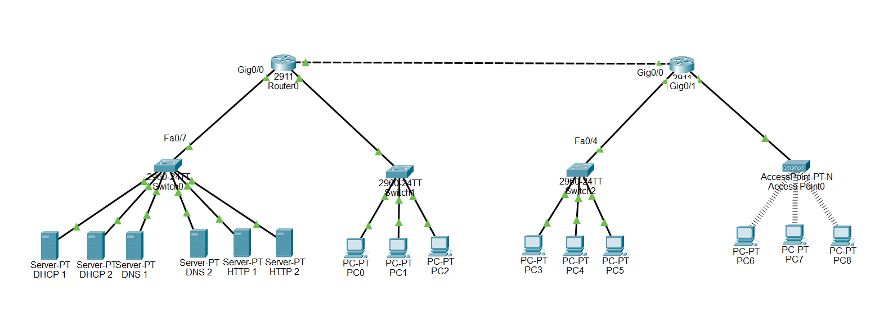

# Réseau d'entreprise siège / agence en dual-stack IPv4/IPv6

Conception, configuration et validation d'un réseau d'entreprise à deux sites sous **Cisco Packet Tracer** : un siège (hôtes et serveurs) et une agence (Wi-Fi et filaire), reliés par un lien point à point. Tout est en dual-stack IPv4/IPv6, avec DHCP redondant relayé entre sites, DNS, HTTP, SSH et Wi-Fi WPA2.

## Compétences démontrées

- Plan d'adressage **VLSM** (IPv4) et plan **hiérarchique** (IPv6, un /56 par site)
- Routage **statique** IPv4 et IPv6 entre deux sites, avec résumé de routes
- **DHCPv4 relayé** (`ip helper-address`) à travers un lien routeur à routeur, avec deux serveurs redondants
- **SLAAC** et option « other-config » côté IPv6
- Services **DNS** et **HTTP**, accès **Wi-Fi** (WPA2-PSK)
- Configuration sécurisée de base : mots de passe chiffrés, comptes locaux en `secret`, **SSH v2** uniquement, ports inutilisés désactivés
- Lecture et explication des tables **ARP** et **NDP**, `ping` et `tracert` (TTL, sauts)
- **Dépannage** documenté : 5 incidents réels, avec symptôme, diagnostic, cause et correction

## Topologie



| Équipement | Modèle | Site | Rôle |
|---|---|---|---|
| RsiegeAdmin | Cisco 2911 | Siège | Routeur du siège |
| SsiegeServeurs | Catalyst 2960 | Siège | Switch du LAN Serveurs |
| SlanHotes | Catalyst 2960 | Siège | Switch du LAN Hôtes |
| Ragence | Cisco 2911 | Agence | Routeur de l'agence |
| SlanFilaire | Catalyst 2960 | Agence | Switch du LAN Filaire |
| AccessPoint0 | AccessPoint-PT-N | Agence | Point d'accès Wi-Fi |

Le siège compte 3 PC (LAN Hôtes) et 6 serveurs (2 DHCP, 2 DNS, 2 HTTP). L'agence compte 3 PC filaires et 3 PC Wi-Fi.

**Câblage**

| Liaison | Câble | Justification |
|---|---|---|
| Routeur - switch, PC - switch, serveur - switch | Droit | Le switch émet sur d'autres paires que le routeur, le PC ou le serveur (MDI-X contre MDI) |
| Routeur - routeur | Croisé | Les deux routeurs émettent sur les mêmes paires (MDI) |
| Routeur - point d'accès | Droit | Accepté par Packet Tracer. Sur du matériel réel, l'AP se branche sur un switch, et l'auto-MDIX rend le type de câble indifférent |

## Plan d'adressage IPv4

Bloc de départ : `172.16.0.0/22`, découpé en VLSM du plus grand au plus petit besoin.

| LAN | Besoin | Réseau | Masque | Passerelle | Switch | Hôtes | Broadcast |
|---|---|---|---|---|---|---|---|
| Hôtes (siège) | 100 | 172.16.0.0/25 | 255.255.255.128 | .1 | .2 | .3 à .126 | .127 |
| Wi-Fi (agence) | 60 | 172.16.0.128/26 | 255.255.255.192 | .129 | aucune (AP) | .130 à .190 | .191 |
| Filaire (agence) | 40 | 172.16.0.192/26 | 255.255.255.192 | .193 | .194 | .195 à .254 | .255 |
| Serveurs (siège) | 12 | 172.16.1.0/28 | 255.255.255.240 | .1 | .2 | .3 à .14 | .15 |
| Lien routeur-routeur | 2 | 172.16.1.16/30 | 255.255.255.252 | | | .17 (siège), .18 (agence) | .19 |

Adresses fixes du LAN Serveurs : DHCP 1 `.3`, DHCP 2 `.4`, DNS 1 `.5`, DNS 2 `.6`, HTTP 1 `.7`, HTTP 2 `.8`. Le détail complet (interfaces, IPv6) est dans [`plan-adressage.md`](plan-adressage.md).

## Plan d'adressage IPv6

Bloc : `2001:db8:beef::/48`, organisé par site pour permettre le résumé de routes.

| Zone | Préfixe | Interface routeur |
|---|---|---|
| Siège (résumé) | 2001:db8:beef:100::/56 | |
| LAN Hôtes | 2001:db8:beef:100::/64 | RsiegeAdmin Gi0/1 : `::1` |
| LAN Serveurs | 2001:db8:beef:101::/64 | RsiegeAdmin Gi0/0 : `::1` |
| Agence (résumé) | 2001:db8:beef:200::/56 | |
| LAN Wi-Fi | 2001:db8:beef:200::/64 | Ragence Gi0/1 : `::1` |
| LAN Filaire | 2001:db8:beef:201::/64 | Ragence Gi0/0 : `::1` |
| Lien routeur-routeur | 2001:db8:beef:300::/64 | siège `::1`, agence `::2` (Gi0/2) |

Les passerelles par défaut des clients sont les adresses link-local : `FE80::1` sur tous les LAN. Sur le lien, le siège est `FE80::1` et l'agence `FE80::2` (deux adresses distinctes sur un même lien). Les switches 2960 n'ont pas d'IPv6 : ils sont gérés en IPv4.

Les clients obtiennent leur adresse par **SLAAC**. L'option « other-config » (`ipv6 nd other-config-flag`) est annoncée sur toutes les interfaces à clients (Hôtes, Wi-Fi, Filaire).

## Routage

Routes statiques explicites, sans route par défaut :

| Routeur | IPv4 | IPv6 |
|---|---|---|
| RsiegeAdmin | `172.16.0.128/25` via `172.16.1.18` | `2001:db8:beef:200::/56` via `2001:db8:beef:300::2` |
| Ragence | `172.16.0.0/25` et `172.16.1.0/28` via `172.16.1.17` | `2001:db8:beef:100::/56` via `2001:db8:beef:300::1` |

**Résumés de routes**
- **Agence en IPv4 :** les deux LAN (`.128/26` et `.192/26`) tiennent dans `172.16.0.128/25` : une seule route côté siège.
- **Siège en IPv4 :** `172.16.0.0/25` et `172.16.1.0/28` ne sont pas contigus. Le plus petit bloc qui les couvre serait `172.16.0.0/23`, qui engloberait aussi l'agence et le lien : le résumé est impossible, donc deux routes.
- **IPv6 :** grâce au plan hiérarchique, chaque site se résume en une seule route `/56`.

**Choix des routes explicites** : le routage est lisible et rien d'inattendu ne part vers l'autre site. Inconvénient : chaque nouveau réseau du siège demande une ligne de plus côté agence. Une route par défaut serait plus simple, mais moins précise.

## Services

### DHCPv4 redondant et relayé

Les deux serveurs DHCP sont au siège (`172.16.1.3` et `172.16.1.4`). Les routeurs relaient les requêtes avec `ip helper-address` vers les deux serveurs, sur les interfaces des LAN clients uniquement : Hôtes (siège), Wi-Fi et Filaire (agence). Le LAN Serveurs n'en a pas besoin, ses machines étant en adresses fixes. Les requêtes de l'agence traversent le lien routeur-routeur.

Chaque serveur possède **3 pools** (Hôtes, Wi-Fi, Filaire) avec le bon masque, la bonne passerelle et un DNS. Les plages ne se chevauchent pas, et la répartition est de **70 % / 30 %** :

| LAN | Hôtes | Serveur 1 (70 %) | Serveur 2 (30 %) |
|---|---|---|---|
| Hôtes | 100 | `.3` à `.72` (70 adresses) | `.73` à `.102` (30 adresses) |
| Wi-Fi | 60 | `.130` à `.171` (42 adresses) | `.172` à `.189` (18 adresses) |
| Filaire | 40 | `.195` à `.222` (28 adresses) | `.223` à `.234` (12 adresses) |

**Compromis de la redondance.** Quand un serveur tombe, le survivant ne dispose que de sa part : aucun serveur ne couvre un LAN à lui seul. Les baux déjà attribués restent valables jusqu'à leur expiration, donc seuls les **nouveaux** clients sont limités. Une durée de bail courte aggraverait la situation. En production, on s'orienterait vers un mécanisme de basculement DHCP ou un partage 50/50 avec des plages plus larges.

**Test de panne (serveur 1 éteint)** : un `ipconfig /renew` sur un PC de chaque LAN donne une adresse issue du serveur 2.

| LAN | Adresse obtenue | Plage du serveur 2 |
|---|---|---|
| Hôtes | `172.16.0.73` | `.73` à `.102` |
| Filaire | `172.16.0.223` | `.223` à `.234` |
| Wi-Fi | `172.16.0.174` | `.172` à `.189` |

### DNS et HTTP

Deux serveurs DNS (`172.16.1.5`, `172.16.1.6`) avec les mêmes enregistrements, et deux serveurs HTTP. `test.com` résout vers `172.16.1.8` depuis les trois LAN clients, et la page web s'affiche depuis le PC Wi-Fi à travers l'AP, les deux routeurs et le LAN Serveurs.

### Wi-Fi

Point d'accès en **WPA2-PSK** (clé partagée, masquée dans ce dépôt). Les PC sans fil reçoivent leur configuration IPv4 par DHCP et IPv6 par SLAAC.

## Sécurité

- `service password-encryption`, `enable secret`, comptes locaux protégés par `secret` (type 5)
- `security passwords min-length 10` sur les routeurs
- Accès distant en **SSH v2 uniquement** sur toutes les lignes VTY (0 à 15), avec `login local`
- Bannière d'avertissement, ports inutilisés en `shutdown`, y compris les ports Gigabit des switches
- Test réel depuis un PC : `ssh -l <compte> 172.16.0.2` (SlanHotes) et `ssh -l <compte> 172.16.1.1` (RsiegeAdmin)

> **Mots de passe :** tous les secrets sont remplacés par `<REDACTED>` dans [`configs/`](configs/). Ce sont des mots de passe de lab sans valeur réelle. Limites assumées : le même mot de passe sert pour `enable` et pour le compte local, et la console des switches et des routeurs utilise un `password` de type 7 (réversible). En production : mots de passe uniques, un compte par administrateur, authentification centralisée (AAA).

## Tests et résultats

| Test | Résultat |
|---|---|
| DHCPv4 : un PC de chaque LAN reçoit adresse, masque, passerelle, DNS | OK |
| SLAAC : adresse globale dans le bon préfixe sur chaque LAN | OK |
| Ping IPv4 Wi-Fi vers Hôtes (TTL=126) | OK |
| Ping IPv6 Filaire vers Hôtes (TTL=126) | OK |
| Ping IPv6 Wi-Fi vers `300::1` (TTL=254) et vers un PC Hôtes (TTL=126) | OK |
| `ping test.com` depuis les 3 LAN clients | OK |
| `http://test.com` depuis le PC Wi-Fi | OK |
| Tolérance de panne DHCP (serveur 1 éteint) | OK |
| SSH vers un switch et vers un routeur | OK |

### Lecture des TTL

Un PC démarre à 128 et un routeur à 255. Le TTL reçu indique donc le nombre de routeurs traversés :
- `ping 172.16.0.3` depuis le Wi-Fi : TTL=126, soit 128 − 2 : deux routeurs.
- `ping 2001:db8:beef:300::1` : TTL=254, soit 255 − 1 : la réponse vient d'un routeur, avec un saut.
- `ping` vers sa propre passerelle : TTL=255, réponse directe du routeur.

(En IPv6, on parle de *Hop Limit*, que Packet Tracer affiche comme TTL.)

### `tracert` entre sites (depuis le PC Wi-Fi)

```
C:\> tracert 172.16.1.5
1   172.16.0.129     (Ragence, Gi0/1)
2   172.16.1.17      (RsiegeAdmin, Gi0/2)
3   172.16.1.5       (DNS 1)

C:\> tracert 2001:DB8:BEEF:100:20C:CFFF:FE97:23DA
1   2001:DB8:BEEF:200::1      (Ragence, Gi0/1)
2   2001:DB8:BEEF:300::1      (RsiegeAdmin, Gi0/2)
3   2001:DB8:BEEF:100:20C:CFFF:FE97:23DA   (PC du LAN Hôtes)
```

Chaque routeur affiche l'adresse de son interface **entrante**, celle par laquelle le paquet est arrivé. C'est pourquoi on ne voit jamais les interfaces de sortie (`.1` ou `100::1`). Le `*` sur le premier paquet du dernier saut vient de la résolution ARP, qui retarde le premier envoi.

### Analyse ARP (RsiegeAdmin)

```
Internet 172.16.0.1     -   0010.11ED.7702  ARPA  GigabitEthernet0/1
Internet 172.16.0.3     42  000C.CF97.23DA  ARPA  GigabitEthernet0/1
Internet 172.16.1.3     64  00D0.BA37.6079  ARPA  GigabitEthernet0/0
Internet 172.16.1.4     64  000C.85C2.81A7  ARPA  GigabitEthernet0/0
Internet 172.16.1.17    -   0010.11ED.7703  ARPA  GigabitEthernet0/2
Internet 172.16.1.18    63  0060.2F28.8B03  ARPA  GigabitEthernet0/2
```

- Un tiret à la place de l'âge désigne une adresse du routeur lui-même : il la possède, il ne l'apprend pas.
- Les autres entrées indiquent les minutes écoulées depuis l'apprentissage.
- Les serveurs DHCP apparaissent parce que le relais leur envoie les requêtes en unicast : le routeur a besoin de leur MAC.
- Sur Ragence, une même MAC apparaît sous deux adresses (par exemple `.130` et `.174`) : après le test de panne, un PC a changé de bail, et l'ancienne entrée reste jusqu'à son vieillissement.

### Analyse NDP (Ragence)

```
2001:DB8:BEEF:200:210:11FF:FEBD:65A2   21  0010.11BD.65A2  REACH  Gig0/1
2001:DB8:BEEF:300::1                   43  0010.11ED.7703  REACH  Gig0/2
FE80::210:11FF:FEBD:65A2               43  0010.11BD.65A2  REACH  Gig0/1
```

NDP remplace ARP en IPv6. Il utilise ICMPv6 (Neighbor Solicitation envoyé à l'adresse multicast *solicited-node*, puis Neighbor Advertisement) plutôt qu'un broadcast. L'état `REACH` indique que la joignabilité a été confirmée récemment. Le voisin `300::1` en `REACH` prouve que le lien routeur-routeur fonctionne en IPv6.

### Adresses SLAAC des serveurs (EUI-64)

Les serveurs ont reçu leur adresse IPv6 par SLAAC. L'identifiant d'interface est construit depuis la MAC : on insère `FFFE` au milieu et on inverse le 7e bit du premier octet (`00` devient `02`).

| Serveur | MAC | Adresse obtenue |
|---|---|---|
| DHCP 1 | 00D0.BA37.6079 | 2001:DB8:BEEF:101:2D0:BAFF:FE37:6079 |
| DHCP 2 | 000C.85C2.81A7 | 2001:DB8:BEEF:101:20C:85FF:FEC2:81A7 |
| DNS 1 | 0060.702C.3984 | 2001:DB8:BEEF:101:260:70FF:FE2C:3984 |
| DNS 2 | 00D0.5808.3B08 | 2001:DB8:BEEF:101:2D0:58FF:FE08:3B08 |
| HTTP 1 | | 2001:DB8:BEEF:101:2D0:FFFF:FE36:3928 |
| HTTP 2 | 0001.C969.AC9A | 2001:DB8:BEEF:101:201:C9FF:FE69:AC9A |

## Incidents rencontrés et dépannage

### 1. Anciennes adresses IPv6 après un changement de plan
- **Symptôme :** après la refonte du plan IPv6, chaque interface de routeur portait deux adresses globales, et le PC Wi-Fi conservait l'ancien préfixe.
- **Diagnostic :** `show running-config` des routeurs, puis `ipconfig /all` sur les clients : l'ancien préfixe `2::/64` était toujours présent.
- **Cause :** les anciennes adresses n'avaient pas été retirées. Les clients gardent une adresse SLAAC jusqu'à la fin de sa durée de validité, même si le routeur ne l'annonce plus.
- **Correction :** suppression des anciennes adresses (`no ipv6 address ...`), puis renouvellement de la configuration sur le client. Le préfixe correct (`200::/64`) apparaît.

### 2. Route manquante vers le LAN Serveurs sur l'agence
- **Symptôme :** détecté à la relecture de la configuration, avant les tests de services. L'agence ne connaissait que le LAN Hôtes du siège.
- **Diagnostic :** `show ip route` sur Ragence.
- **Cause :** aucune route vers `172.16.1.0/28`, où se trouvent les serveurs DHCP et DNS. Les requêtes relayées n'auraient pas pu partir.
- **Correction :** ajout de `ip route 172.16.1.0 255.255.255.240 172.16.1.17`. Le DHCP relayé et le DNS fonctionnent depuis l'agence.

### 3. Option « other-config » oubliée sur un LAN
- **Symptôme :** détecté à la relecture : l'interface du LAN Hôtes du siège n'annonçait pas l'option, contrairement à celles de l'agence.
- **Cause :** commande `ipv6 nd other-config-flag` oubliée sur Gi0/1.
- **Correction :** commande ajoutée, le comportement est identique sur tous les LAN clients.

### 4. Mauvais serveur DNS dans un pool DHCP
- **Symptôme :** un PC filaire recevait `172.16.0.5` comme DNS, une adresse du LAN Hôtes qui n'est pas celle d'un serveur.
- **Diagnostic :** `ipconfig /all` sur le PC, comparaison avec le plan d'adressage.
- **Cause :** faute de frappe dans le champ DNS d'un pool filaire.
- **Correction :** pool corrigé, puis `ipconfig /renew` : le DNS reçu est `172.16.1.5`.

### 5. PC Wi-Fi sans passerelle IPv6
- **Symptôme :** le ping IPv6 du PC Wi-Fi vers l'autre site échouait à 100 %.
- **Diagnostic, couche par couche :**
  - le ping de sa passerelle `200::1` réussit : le lien local est bon ;
  - le ping de `300::1` échoue : la sortie du LAN est impossible ;
  - depuis le PC filaire, le ping vers un PC Hôtes réussit : le routage est donc correct ;
  - `ipconfig /all` du PC Wi-Fi montre `Default Gateway : ::` en IPv6.
- **Cause :** le PC Wi-Fi n'avait pas enregistré de passerelle par défaut IPv6, malgré un préfixe correct.
- **Correction :** après un `ipconfig /renew`, la passerelle `FE80::1` apparaît et les pings inter-sites réussissent. Le comportement a été **observé** sur la carte sans fil de Packet Tracer, sans avoir été démontré.

## Limites de Packet Tracer

| Limite | Contournement ou configuration cible |
|---|---|
| Relais DHCPv6 (`ipv6 dhcp relay destination`) indisponible sur le 2911 | SLAAC seul pour l'IPv6. Les clients n'ont pas de DNS via DHCPv6, mais le DNS reste joignable en IPv4 (dual-stack). Cible réelle : relais DHCPv6 + flag O + serveurs DHCPv6 sans état |
| Champ « nom de domaine » absent du DHCP des serveurs | Cible réelle : option DHCP 15 |
| Adresses IPv6 statiques des serveurs qui disparaissent à la réouverture de la fenêtre | Serveurs en SLAAC (tableau ci-dessus). Plan cible : `2001:db8:beef:101::3` à `::8` |
| `security passwords min-length` absent sur les switches 2960 | Appliqué sur les routeurs uniquement |
| Un point d'accès ne peut pas recevoir d'adresse IP | Sur du matériel réel : IP de gestion, branché sur un switch |
| Le champ « DHCP Servers » de `ipconfig` ne reflète pas toujours le serveur qui a réellement répondu | Se fier aux adresses obtenues et au test de panne |

## Pistes d'amélioration

- Remplacer le VLAN 1 par un VLAN de gestion dédié, et segmenter les LAN en VLAN
- Ajouter des ACL entre les LAN et vers les serveurs
- Passer au routage dynamique (OSPF) et ajouter du NAT vers l'extérieur
- Mettre en place AAA pour centraliser l'authentification
- Utiliser WPA2-Enterprise (802.1X) pour le Wi-Fi
- Remplacer la répartition fixe 70/30 du DHCP par un basculement DHCP

## Fichiers du dépôt

```
.
├── README.md
├── plan-adressage.md
├── topologie.pkt
├── images/
│   └── topologie.png
└── configs/
    ├── RsiegeAdmin.txt
    ├── SsiegeServeurs.txt
    ├── SlanHotes.txt
    ├── Ragence.txt
    └── SlanFilaire.txt
```

## Outils

Cisco Packet Tracer
